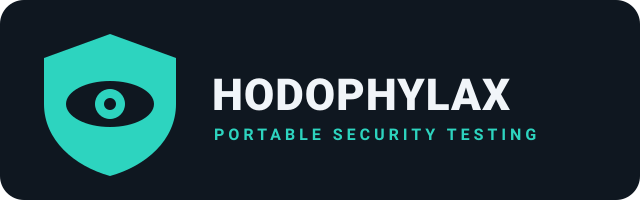

<p align="center">
  
</p>

# Watchdog Project

A portable security-testing kit on a single drive. Plug the SSD into any Windows or
Mac machine, run one command, and you get Kali Linux in a VM plus an AI assistant —
with your choice of **local models or a cloud API** — all without installing anything
on the host.

> For **authorized** security testing only (your own labs, engagements you have written
> permission for, CTFs). See [docs/security.md](docs/security.md).

## Why

Existing projects each do one piece — portable QEMU, a WSL Kali launcher, or an AI
pentest harness that needs Docker. Watchdog ties them together into a true
plug-and-run drive: one entry point, automatic machine checks, a local AI that drives
the tools, and a config file to swap the OS, the models, and the harness.

## What you get

- **Kali in QEMU**, launched from the drive, on Windows (bundled QEMU + SPICE, nothing
  to install) and macOS (uses Homebrew QEMU; the checker offers to install it).
- **One command**: `watchdog-run` checks the machine, asks whether to start the local AI,
  then opens Kali. Two-way clipboard and free mouse capture are set up for you.
- **Local AI** running on the host GPU (not inside the VM, so it stays fast) and reached
  from Kali at `http://10.0.2.2:8080`. A tiny proxy makes models that emit plain-JSON
  tool calls (e.g. WhiteRabbitNeo) work as real agents.
- **Cloud API too**: point the harness at Claude, OpenAI, or OpenRouter with your own
  key when you want a bigger model. Keys live in an environment variable, never on the
  drive. See [docs/configure.md](docs/configure.md).
- **Configurable** through one `watchdog.json`: the guest OS image, the model list, and
  the harness.

## Quick start

1. Format a USB SSD as **exFAT** (label `WATCHDOG`) and copy this repo's `drive/` folder
   contents to its root. See [docs/install.md](docs/install.md).
2. Plug it in and run **`watchdog-run`** from the root (`.\watchdog-run.bat` on Windows,
   `bash watchdog-run.command` on macOS). The first time, it sees the drive isn't set up and
   **offers to download Kali + the default model (~6 GB) — say yes.** (Or run the provisioner
   directly: `setup\provision.ps1` on Windows, `bash setup/provision-mac.sh` on macOS. Edit
   `config/watchdog.json` first to change the OS or models.)
3. The first time Kali boots, run the one-time in-guest setup (see
   [docs/usage.md](docs/usage.md#first-time-inside-kali-run-once)). After that the agent
   keeps itself up to date automatically on every login.

Default Kali login is `kali` / `kali` — change it immediately with `passwd`.

## How it works

```
Host machine                                  Guest (Kali in QEMU)
┌──────────────────────────────┐              ┌─────────────────────────┐
│ watchdog-run → preflight      │              │ Watchdog agent (OpenCode)│
│ start-llm → llama.cpp + proxy │◄── 10.0.2.2 ─┤  → runs nmap, sqlmap... │
│   (GPU, flash-attn)           │   :8080/v1   │  → reads ./scope.md     │
│ start-kali → QEMU + SPICE     │              │  → writes ./report/*.md │
└──────────────────────────────┘              └─────────────────────────┘
```

The AI can also be a cloud model: the harness just points at a different endpoint and
reads your API key from the environment.

## Configure it

Edit `config/watchdog.json` (copy from `watchdog.example.json`):

- **os** — any Debian-based system that boots under QEMU (Kali default; Parrot/Ubuntu by
  changing the image URL and hash).
- **models** — add or remove GGUF files; mark `"tool_shim": true` for models that print
  plain-JSON tool calls.
- **harness** — `opencode` (tested) and its endpoint; swap in another OpenAI-compatible
  agent if you prefer.

See [docs/configure.md](docs/configure.md) for cloud APIs, other models, and other
systems.

## Status

Built and tested on Windows 11 with an RTX 4060. The launcher scripts, the tool-call
proxy, and the one-command flow are verified end to end. macOS scripts are written and
syntax-checked but not yet run on real hardware. The provisioner is new — review it and
run it with care. Contributions and bug reports welcome.

## License

MIT — see [LICENSE](LICENSE). Kali, QEMU, llama.cpp, the models, and OpenCode keep their
own licenses; Watchdog only orchestrates them and bundles none of their binaries.
